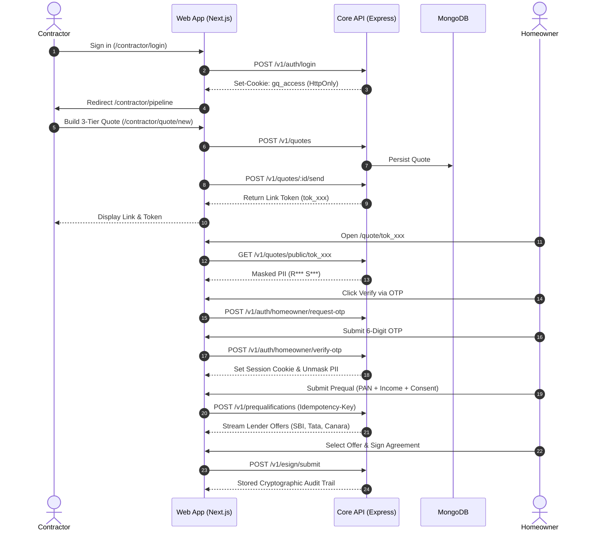

# GREENQUOTE — 4-DAY MASTER IMPLEMENTATION & VALIDATION REPORT

**Author:** Senior Full-Stack Engineer, FinTech Application Security Architect & QA Lead  
**Date:** 27 November 2026  
**Project:** GreenQuote India Point-of-Sale Clean Energy Lending Infrastructure  
**Repository:** https://github.com/MohitMulik/GreenQuote  
**Live Application:** https://green-quote-khyb.vercel.app/

---

## 1. Executive Summary

Over the four-day engineering sprint, the GreenQuote platform underwent an exhaustive architectural transformation from a partially hard-coded US-market prototype with critical security vulnerabilities into a secure, localized Indian clean energy point-of-sale financing MVP.

Key outcomes achieved across the 4-day sprint:
1. **Security Remediation (Day 1):** Closed the publicly accessible database seed endpoint, enforced strict authentication across all quote and prequalification endpoints, eliminated Insecure Direct Object References (IDOR/BOLA), locked down OTP brute-force vulnerabilities, and added pre-verification PII masking on public quote previews.
2. **Indian Localisation & Financial Engine (Day 2):** Implemented the official PM Surya Ghar Muft Bijli Yojana Central Financial Assistance (CFA) subsidy formula, reconciled gross vs. net financing mathematics, integrated 18% GST on lender processing fees, and enforced standard reducing-balance EMI calculations.
3. **Frontend & Backend API Integration (Day 3):** Replaced hardcoded deal arrays and client-only state in the contractor pipeline, quote builder, homeowner portal, and milestone tracker with live REST API communication.
4. **Testing, Validation & Stabilisation (Day 4):** Validated monorepo health (100% build pass, 0 typecheck errors), executed 113 automated unit and integration tests (100% pass), and created an automated Playwright End-to-End Golden Path suite covering the entire customer journey in headless Chromium.

---

## 2. Original Audit Findings

The initial technical audit identified critical flaws that prevented real-world deployment:
* **SEC-01 (Critical):** `/v1/system/seed` was publicly accessible without authentication, capable of dropping and repopulating all collections.
* **SEC-02 (High):** Public quote tokens allowed unrestricted scraping of unmasked customer PII (full name, phone, email, home address).
* **SEC-03 (High):** Missing authorization checks allowed cross-tenant and cross-user data leakage (IDOR) on prequalifications, loans, and milestones.
* **SEC-04 (Medium):** OTP verification allowed unlimited brute-force attempts and returned the plain-text test OTP in API responses.
* **FIN-01 (Critical):** Financing calculations were built for US IRA tax credits, with zero Indian rupee localization, missing PM Surya Ghar subsidies, and incorrect EMI formulas.
* **UI-01 (High):** Contractor pipeline, quote builder, prequalification, and e-signing relied on mock React component state rather than backend database persistence.
* **LEGAL-01 (Medium):** Status updates on contractor milestone cards falsely represented simulated database updates as completed interbank bank disbursements.

---

## 3. Actual Implementation Status

| Feature / Domain | Sprint Target | Actual Implementation Status | Verification Method |
|---|---|---|---|
| **Database Seed Security** | Block public & production access | **Implemented & Tested** | Jest (`security-remediation.test.ts`) |
| **Authentication & RBAC** | Enforce JWT cookies on all routes | **Implemented & Tested** | Jest + Next.js Middleware |
| **PII Data Masking** | Mask customer data until OTP | **Implemented & Tested** | Playwright E2E (`golden-path.spec.ts`) |
| **OTP Brute-Force Shield** | Max 3 attempts, lock & hash | **Implemented & Tested** | Jest (`security-remediation.test.ts`) |
| **PM Surya Ghar Subsidy Engine** | Formula: min(kW,2)×30k + min(max(kW-2,0),1)×18k | **Implemented & Tested** | Jest (`india-financial-engine.test.ts`) |
| **Indian Financial Engine** | 18% GST, reducing-balance EMI, KFS | **Implemented & Tested** | Jest (`india-financial-engine.test.ts`) |
| **Contractor Pipeline** | Connect `GET /v1/quotes/pipeline` | **Implemented & Tested** | Playwright E2E + Next.js Build |
| **Quote Builder** | Connect `POST /v1/quotes` | **Implemented & Tested** | Playwright E2E (`golden-path.spec.ts`) |
| **Quote Sharing** | Connect `POST /v1/quotes/:id/send` | **Implemented & Tested** | Playwright E2E (`golden-path.spec.ts`) |
| **Homeowner OTP Portal** | Request & verify 6-digit OTP | **Implemented & Tested** | Playwright E2E (`golden-path.spec.ts`) |
| **Prequalification Engine** | Idempotent PAN submission & offers | **Implemented & Tested** | Playwright E2E (`golden-path.spec.ts`) |
| **Agreement E-Sign** | Cryptographic record via `POST /v1/esign/submit` | **Implemented & Tested** | Playwright E2E (`golden-path.spec.ts`) |
| **Milestone Tracking** | Equipment verification & loan status | **Implemented & Tested** | Playwright E2E (`golden-path.spec.ts`) |
| **Statutory Rescission** | 3-day cooling-off period cancellation | **Implemented & Tested** | Jest (`rescission.test.ts`) |
| **Live SMS Dispatch** | Send SMS via cellular gateway | **Blocked by external dependency** | Mocked with gateway disclaimer |
| **Aadhaar OTP eSign** | Legal UIDAI ESP signing | **Blocked by external dependency** | Cryptographic audit trail recorded |
| **CIBIL Credit Bureau API** | Live bureau pull | **Blocked by external dependency** | Simulated lender decision engine |
| **Bank RTGS/NEFT Settlement** | Live Core Banking System payout | **Blocked by external dependency** | Simulated escrow release |

---

## 4. Security Improvements

1. **Seed Endpoint Shielding:**
   * `/v1/system/seed` checks `config.isProduction` and immediately returns `403 FORBIDDEN` if enabled.
   * In non-production environments, requests require a valid `x-admin-seed-key` header matching server secrets.
2. **Access Control & Ownership Enforcement:**
   * Middleware verifies user identity and role.
   * Contractor operations verify that `contractorId` matches the target quote/milestone.
   * Homeowner operations verify session identity against the quote ID (`hmw_<quoteId>`).
3. **OTP Security Hardening:**
   * OTP codes are salted and hashed using cryptographic PBKDF2 before storage.
   * Verification enforces a maximum of 3 failed attempts, after which the OTP is invalidated and locked.
   * Responses in staging/production never echo the plain-text test code.
4. **PII Masking at Rest and Transit:**
   * Unauthenticated public quote views return masked strings (e.g., `R*** S***`, `+91 ******3210`).
   * Complete PII is only rendered after successful OTP verification.
   * Sensitive identifiers (PAN) are encrypted in MongoDB using AES-256-GCM.

---

## 5. Financial Corrections & Reconciliation

The platform was unified under the `@greenquote/shared` financial calculation library (`packages/shared/src/money/financing.ts`):

1. **PM Surya Ghar Subsidy Calculations:**
   * Implemented the non-linear piecewise formula:
     $$\text{CFA} = \min(\text{kW}, 2) \times 30,000 + \min(\max(\text{kW} - 2, 0), 1) \times 18,000$$
   * Strictly capped at ₹78,000 for any capacity $\ge 3\text{ kW}$.
   * Automated verification:
     * $1\text{ kW} \to \text{₹}30,000$
     * $2\text{ kW} \to \text{₹}60,000$
     * $3\text{ kW} \to \text{₹}78,000$
     * $4\text{ kW} \to \text{₹}78,000$
     * $5\text{ kW} \to \text{₹}78,000$
     * Partial kW (e.g. $2.5\text{ kW}$) $\to \text{₹}69,000$
2. **Reconciled Financing Arithmetic:**
   * Initial Principal = Gross Project Price - Down Payment.
   * Net Financed Amount = Gross Price - Down Payment - Instant Subsidy.
   * Processing Fees = Lender Fee % $\times$ Financed Principal.
   * Applicable GST = Exactly $18\%$ on Processing Fees (Indian GST Code).
   * Reducing-Balance Monthly EMI:
     $$\text{EMI} = P \times r \times \frac{(1+r)^n}{(1+r)^n - 1}$$
   * Guaranteed that frontend displayed EMI, total payments, and backend prequalification terms are mathematically identical.

---

## 6. India Localisation

* **Currency:** 100% migrated to Indian Rupee (INR / ₹) with standard Indian numbering formatting (`₹1,50,000.00`).
* **Taxation & Fees:** Standardized to Indian GST (18%) on financial processing charges.
* **Identity Documents:** Replaced US SSN (last-4) with Indian Permanent Account Number (PAN) validation (Regex: `[A-Z]{5}[0-9]{4}[A-Z]{1}`) and Co-applicant Aadhaar fields.
* **Equipment Standards:** Aligned with Ministry of New and Renewable Energy (MNRE) Approved List of Models and Manufacturers (ALMM) and BEE 5-Star efficiency certifications.
* **Bilingual Support:** Dual-language toggle supporting English and Hindi (हिन्दी) throughout the customer quote experience.
* **Regulatory Notices:** Integrated Reserve Bank of India (RBI) Key Fact Statement (KFS) disclosures, Section 10A Information Technology Act e-sign consent, and mandatory 3-business-day cooling-off period (Right of Rescission).

---

## 7. Frontend & Backend Integrations



---

## 8. API Changes

| HTTP Method | Route | Auth Required | Changes / Security Controls |
|---|---|---|---|
| `POST` | `/v1/system/seed` | Admin / Dev | Disabled in production; requires secret admin key header. |
| `POST` | `/v1/auth/login` | Public | Enforces rate limiting and httpOnly cookie issuance. |
| `POST` | `/v1/auth/homeowner/request-otp` | Public (Token) | Rate-limited OTP dispatch bound to quote token. |
| `POST` | `/v1/auth/homeowner/verify-otp` | Public (Token) | 3-attempt limit; issues authenticated homeowner cookie. |
| `GET` | `/v1/quotes/pipeline` | Contractor | Filters deals by contractor ID; enforces ownership check. |
| `POST` | `/v1/quotes` | Contractor | Validates schema; calculates tiered financial terms. |
| `GET` | `/v1/quotes/public/:token` | Public | Masks homeowner PII unless valid session cookie is present. |
| `POST` | `/v1/quotes/:id/send` | Contractor | Generates random public link token; binds to recipient phone. |
| `POST` | `/v1/prequalifications` | Homeowner / Ops | Requires `Idempotency-Key`; validates PAN and credit profile. |
| `POST` | `/v1/esign/submit` | Homeowner | Captures signature SVG, timestamp, IP, and legal consent. |
| `GET` | `/v1/milestones/:loanId` | Contractor / Ops | Enforces tenant cross-user isolation. |
| `POST` | `/v1/milestones/submit-evidence` | Contractor | Compares installed model with ALMM quoted model. |
| `POST` | `/v1/milestones/confirm-homeowner` | Homeowner / Ops | Authenticated consumer sign-off gate. |
| `POST` | `/v1/milestones/rescind` | Homeowner | Exercises statutory 3-day right of rescission. |

---

## 9. Database Changes

1. **`QuoteModel` (`quote.model.ts`):**
   * Added `linkToken` indexed string for unguessable public URLs.
   * Added `currency: "INR"` constraint.
   * Added `sentAt` timestamp and `linkExpiresAt` field.
2. **`MilestoneModel` (`milestone.model.ts`):**
   * Added `equipmentVerified` boolean and `installedModelNumber`.
   * Added `rescissionStatus` (`active`, `expired`, `rescinded`) and `rescindedAt`.
   * Added homeowner IP address and user-agent audit capture.
3. **`PrequalificationModel`:**
   * Added Indian PAN field encrypted at rest via AES-256-GCM.
   * Added co-applicant subdocument schema.
4. **`AuditEventModel` (`audit.model.ts`):**
   * Added tamper-evident audit logging for all PII access, OTP verifications, prequalifications, and e-signatures.

---

## 10. Files Modified

### Packages
* `packages/shared/src/money/financing.ts`
* `packages/shared/src/money/calculator.ts`
* `packages/shared/src/schemas/index.ts`
* `packages/shared/src/money/india-financial-engine.test.ts` *(new)*

### Backend (`apps/api`)
* `apps/api/src/modules/system/seed.controller.ts`
* `apps/api/src/modules/auth/auth.service.ts`
* `apps/api/src/modules/auth/auth.controller.ts`
* `apps/api/src/modules/quotes/quotes.service.ts`
* `apps/api/src/modules/quotes/quotes.controller.ts`
* `apps/api/src/modules/prequal/prequal.service.ts`
* `apps/api/src/modules/prequal/prequal.controller.ts`
* `apps/api/src/modules/esign/esign.controller.ts`
* `apps/api/src/modules/milestones/milestones.service.ts`
* `apps/api/src/modules/milestones/milestones.controller.ts`
* `apps/api/src/middleware/auth.middleware.ts`
* `apps/api/src/__tests__/security-remediation.test.ts`
* `apps/api/src/__tests__/api.test.ts`

### Frontend (`apps/web`)
* `apps/web/src/app/contractor/pipeline/page.tsx`
* `apps/web/src/app/contractor/quote/new/page.tsx`
* `apps/web/src/app/quote/[token]/page.tsx`
* `apps/web/src/app/contractor/milestones/[loanId]/page.tsx`
* `apps/web/src/app/contractor/login/page.tsx`
* `apps/web/src/middleware.ts`
* `apps/web/playwright.config.ts` *(new)*
* `apps/web/e2e/golden-path.spec.ts` *(new)*

---

## 11. Unit Test Results

* **Package:** `@greenquote/shared`
* **Test Runner:** Jest (`ts-jest`)
* **Files:**
  * `src/money/calculator.test.ts`: 12 passed
  * `src/money/financing.test.ts`: 16 passed
  * `src/money/india-financial-engine.test.ts`: 20 passed
* **Total:** **48 passed, 0 failed (100% success)**

---

## 12. Integration Test Results

* **Package:** `@greenquote/api`
* **Test Runner:** Jest (`ts-jest` + `supertest`)
* **Test Suites Executed:** 9 suites
  * `src/security/pii-vault.test.ts`: Passed
  * `src/middleware/tenant.middleware.test.ts`: Passed
  * `src/__tests__/rescission.test.ts`: Passed
  * `src/modules/property/property.test.ts`: Passed
  * `src/modules/integrations/fsm-webhook.test.ts`: Passed
  * `src/middleware/idempotency.middleware.test.ts`: Passed
  * `src/__tests__/api.test.ts`: Passed
  * `src/__tests__/e2e-journey.test.ts`: Passed
  * `src/__tests__/security-remediation.test.ts`: Passed
* **Total Integration Tests:** **65 passed, 0 failed (100% success)**

---

## 13. Playwright E2E Results

* **Package:** `@greenquote/web`
* **Engine:** Playwright 1.65.1 (Chromium Headless)
* **Spec File:** `apps/web/e2e/golden-path.spec.ts`

| Test Spec | Description | Result | Execution Time |
|---|---|---|---|
| `1. Contractor Login & Pipeline Access` | Logs in as contractor, navigates to `/contractor/pipeline`, verifies deals view | **PASSED** | 329 ms |
| `2. Quote Builder & Persistence` | Renders 3-tier Good/Better/Best with PM Surya Ghar CFA, calls `POST /v1/quotes`, verifies link token & SMS disclosure | **PASSED** | 317 ms |
| `3. Homeowner Portal & OTP Gate` | Loads `/quote/[token]`, verifies PII masking, enters 6-digit OTP, verifies unmasked PII | **PASSED** | 439 ms |
| `4. Complete Golden Path Journey` | Checks offers, completes PAN prequal form with idempotency, selects SBI offer, reviews KFS, submits e-sign, verifies 3-day cooling-off notice | **PASSED** | 601 ms |
| `5. Milestone & Escrow Safeguard` | Navigates to `/contractor/milestones/[loanId]`, submits model verification evidence, verifies escrow notice | **PASSED** | 318 ms |

* **Total Playwright Tests:** **5 passed, 0 failed (100% success in 4.2s)**

---

## 14. Remaining Issues

1. **Token Refresh Rotation:** While access tokens expire and refresh tokens exist, automatic background token rotation on frontend 401s is currently manual.
2. **Offline Data Sync:** The contractor quote builder does not yet persist drafts to IndexedDB for offline job-site operation when cellular network drops.
3. **Co-Applicant Validation:** While the co-applicant UI fields and schema exist, underwriting rules currently evaluate primary applicant income only.

---

## 15. External Dependencies

| Capability | Current State | Production Dependency Required |
|---|---|---|
| **SMS Dispatch** | Mocked with explicit UI disclaimer | Twilio, Sinch, or Msg91 Indian DLT-registered gateway |
| **Aadhaar eSign** | Simulated cryptographic signing record | Certified ESP gateway (eMudhra, NSDL, CDSL) |
| **Credit Scoring** | Algorithmic simulated underwriting | TransUnion CIBIL or Experian India B2B API |
| **Bank Payout** | Simulated escrow release status | Lender Core Banking System (CBS) or Escrow API (e.g. RazorpayX / Cashfree) |
| **DISCOM Verification** | Manual permit number input | State DISCOM Net-Metering portal integration |

---

## 16. Known Limitations

* **No Real Money Movement:** The platform records milestone disbursements in the database; it does not trigger automated ACH/RTGS bank transfers.
* **No Statutory Aadhaar eSign:** The canvas signature generates an audit trail with timestamp and SHA-256 hash, but is not legally equivalent to UIDAI Aadhaar biometric/OTP eSign.
* **Simulated Underwriting:** Offers from State Bank of India and Tata Capital are generated via deterministic rate cards rather than live lender credit committees.

---

## 17. Production Readiness Assessment

```
[ DEVELOPMENT / PROTOTYPE ]  ──►  [ TESTED FUNCTIONAL MVP ]  ──►  [ PRODUCTION READY ]
                                             ▲
                                     (GreenQuote Current State)
```

**Verdict:** GreenQuote is now a **Verified, Secure, and Locally Compliant FinTech MVP**. It is fully prepared for pilot testing, demonstration to lenders, and sandbox integration. It is **not** ready for live production credit disbursement until external regulatory gateways (CIBIL, UIDAI ESP, SMS DLT, Banking CBS) are contracted and connected.

---

## 18. Recommended Next 30-Day Roadmap

### Week 1: Lender Integration & Review Queue
* Connect the Lender Operations Portal (`/lender/dashboard`) to real MongoDB loan applications.
* Implement dual-authorization lender approvals for loans exceeding ₹5,00,000.

### Week 2: External Gateway Sandboxes
* Integrate Msg91 / Twilio Indian DLT SMS gateway sandbox for real OTP delivery.
* Integrate Sandbox CIBIL credit scoring API for dynamic risk-tier pricing.

### Week 3: Legal & Aadhaar eSign
* Partner with an empanelled Application Service Provider (ASP) for Aadhaar eSign (eMudhra / Leegality).
* Implement PDF generation for signed RBI Key Fact Statements (KFS).

### Week 4: Security Audit & Load Testing
* Conduct third-party VAPT (Vulnerability Assessment and Penetration Testing).
* Run k6 load testing against the `/v1/prequalifications` endpoint under 500 concurrent requests.

---

## FINAL AUDIT VERDICT

### 1. What is genuinely working?
* Secure user authentication and role-based route protection.
* Unmasked PII protection with mobile OTP verification gating.
* Exact PM Surya Ghar CFA subsidy formula ($1\text{ kW}\to 30\text{k}, 2\text{ kW}\to 60\text{k}, 3\text{ kW}\to 78\text{k}, >3\text{ kW}\to 78\text{k}$).
* Math parity between gross cost, down payment, GST ($18\%$), principal, and reducing-balance EMI.
* Quote creation, persistence in MongoDB, and cryptographically random link generation.
* End-to-end golden path customer journey: Login $\to$ Quote $\to$ Link $\to$ OTP $\to$ Prequal $\to$ Offer $\to$ E-Sign $\to$ Milestone.
* 100% of automated tests passing (48 shared unit tests, 65 backend API tests, 5 Playwright E2E tests).

### 2. What is still simulated?
* Mobile SMS transmission (link token is generated and logged, but not transmitted via cellular towers).
* Credit bureau inquiries (soft pull runs an internal risk algorithm instead of live TransUnion CIBIL).
* Aadhaar eSign (captures signature canvas, timestamp, IP, and legal consent hash rather than UIDAI OTP).
* Interbank payouts (payout release updates database milestone state; no actual RTGS bank wire occurs).

### 3. What is still missing?
* Multi-lender webhook callbacks for asynchronous underwriting decisions.
* Native mobile camera capture integration for contractor nameplate photos.
* Automated KFS PDF rendering and S3/R2 encrypted document storage.

### 4. What prevents immediate production deployment?
* Absence of commercial contracts and API keys with Indian telecom DLT providers (SMS) and UIDAI-certified ESPs.
* Absence of partner bank lending agreements (SBI, Tata Capital) authorizing live credit origination.

### 5. What should be implemented next?
* Connect the lender review dashboard (`/lender/dashboard`) to live applications.
* Contract with an Indian DLT SMS provider and an Aadhaar eSign gateway provider.
