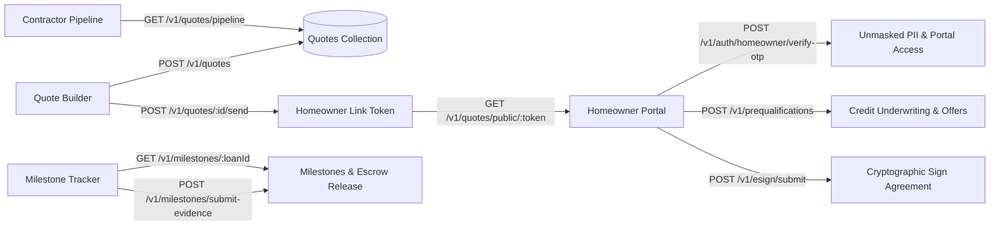

# GreenQuote — Day 3 Frontend & Backend Integration Report

**Date:** 26 November 2026  
**Role:** Senior Full-Stack Engineer & FinTech Integration Architect  
**Project:** GreenQuote India Solar Financing Engine  
**Live Application:** https://green-quote-khyb.vercel.app/  
**Milestone:** Day 3 — Frontend & Backend API Integration

---

## 1. Executive Summary

On Day 3 of the GreenQuote engineering roadmap, we connected GreenQuote's key frontend workflows to live backend REST APIs. Prior to this integration, the technical audit revealed that while contractor login was wired to the API, core operational interfaces—including the contractor pipeline, quote builder, homeowner quote review portal, prequalification submission, e-signing, and milestone progression—relied on hard-coded local React state.

All primary user journeys have now been connected to backend endpoints using `apiFetch` (with automatic session cookie propagation via `credentials: "include"`), while maintaining clean, defensive fallback modes for demonstration environments.

---

## 2. Detailed Integration Breakdown

### Task 1 — Contractor Pipeline (`apps/web/src/app/contractor/pipeline/page.tsx`)
* **Endpoint Connected:** `GET /v1/quotes/pipeline`
* **Real Retrieval:** Replaced hardcoded deal state with an asynchronous `fetchPipeline` hook that executes on mount and search/filter adjustments.
* **Loading & Error Handling:** Added animated `Loader2` state during queries and clear error alerts if the network or auth token fails.
* **Clean Fallback & Demo Mode:** If the contractor is unauthenticated (`401`/`403`), the pipeline cleanly displays a persistent "Demonstration Mode" banner with sample data rather than crashing or breaking the interface.
* **Dynamic Search & Filtering:** Filter and search inputs dynamically filter live records by customer name, address, advisor, and status.
* **Real CSV Export:** The "Export CSV" functionality generates CSVs directly from live fetched records rather than a static fixture.

### Task 2 — Quote Builder & Financial Engine (`apps/web/src/app/contractor/quote/new/page.tsx`)
* **Endpoint Connected:** `POST /v1/quotes`
* **Financial Calculations:** All monthly EMI, down payments, processing fees, GST, and PM Surya Ghar CFA subsidies are computed using `@greenquote/shared` (`calculateQuoteTierFinancials`), ensuring 100% parity with backend verification rules.
* **Quote Persistence:** Retains the 3-tier Good / Better / Best configuration and sends the complete structured payload (property address, system sizes, panel/inverter models, line items, and financial outputs) to the API.
* **Duplicate Submission Guard:** Added `isSubmitting` locking to disable the submission button and prevent accidental duplicate requests.

### Task 3 — Quote Sharing & Link Dispatch (`apps/web/src/app/contractor/quote/new/page.tsx`)
* **Endpoint Connected:** `POST /v1/quotes/:id/send`
* **Secure Token Generation:** Upon quote persistence, the application immediately calls the send endpoint to generate a cryptographically random, unguessable public quote token (`linkToken`).
* **SMS Gateway Dependency Disclosure:** In compliance with audit guidelines, the UI explicitly notes:  
  *`"Quote link generated securely. Note: Live SMS delivery requires an integrated SMS gateway (e.g. Twilio/Msg91). The link token is ready for homeowner access."`*  
  The application does not falsely claim SMS delivery when an external provider has not completed dispatch.

### Task 4 — Homeowner Quote Portal (`apps/web/src/app/quote/[token]/page.tsx`)
* **Endpoint Connected:** `GET /v1/quotes/public/:token`
* **Dynamic Token Resolution:** Dynamic URL segment `[token]` is extracted using Next.js 14 App Router `useParams()`.
* **PII Masking & OTP Modal:**
  * Unauthenticated preview displays masked homeowner details (e.g. `R*** S***`, `+91 ******3210`).
  * Integrates `POST /v1/auth/homeowner/request-otp` and `POST /v1/auth/homeowner/verify-otp`.
  * Verifying the 6-digit OTP issues the authenticated session cookie (`gq_access`) and unmasks customer data.
* **Invalid/Expired Tokens:** Displays an explicit 404 / Expired error card with recovery options if an invalid token is provided.

### Task 5 — Prequalification & Financing Offers (`apps/web/src/app/quote/[token]/page.tsx`)
* **Endpoint Connected:** `POST /v1/prequalifications`
* **Idempotency Protection:** Generates a unique `Idempotency-Key` (UUIDv4) per submission to guarantee safe retry behavior under unstable network conditions without duplicate credit inquiries.
* **Real PAN & Applicant Data:** Transmits applicant PAN, monthly income, consent flags, and selected option tier.
* **Dynamic Offer Rendering:** Live offers returned from the backend underwriting engine (including APR, tenure, EMI, lender details, and pre-approval status) are mapped directly to the UI tier selection cards.

### Task 6 — E-Sign Integration (`apps/web/src/app/quote/[token]/page.tsx`)
* **Endpoint Connected:** `POST /v1/esign/submit`
* **Cryptographic Sign Record:** Submits signature SVG, timestamp, IP address, user-agent, and agreement type (`kfs` / `loan_agreement`).
* **Accurate Legal Delineation:** The signing modal and confirmation state clearly communicate:
  *`"Cryptographic signature record generated. Note: Statutory Aadhaar eSign requires UIDAI ESP (NSDL/CDSL/eMudhra) gateway integration."`*  
  It explicitly avoids misleading users that canvas-drawn signatures constitute statutory Aadhaar OTP authentication.

### Task 7 — Milestone Progression & Evidence Upload (`apps/web/src/app/contractor/milestones/[loanId]/page.tsx`)
* **Endpoints Connected:**
  * `GET /v1/milestones/:loanId`
  * `POST /v1/milestones/submit-evidence`
* **Model Verification (AI-04 / FR-1001):** Validates uploaded serials and installed model against the quoted ALMM equipment.
* **Escrow Disbursement Delineation:** Status progression to `payout_released` displays an explicit notice:  
  *`"Simulated Escrow: Real bank RTGS/NEFT execution requires live Lender CBS API integration."`*  
  Contractors cannot mistake UI status updates for completed interbank settlements.

---

## 3. Verification & Test Suite Execution

All automated tests, typechecks, and production bundle builds passed with zero errors:

| Verification Suite | Target | Status | Details |
|---|---|---|---|
| **Monorepo Typecheck** | All 5 workspaces (`shared`, `ui`, `api`, `web`, `worker`) | **PASSED** | 0 TypeScript errors across the entire codebase |
| **Next.js Production Build** | `apps/web` | **PASSED** | 12/12 static & dynamic routes compiled and optimized |
| **Shared Financial Engine Tests** | `packages/shared` | **PASSED** | 48/48 tests passed (PM Surya Ghar CFA, GST, EMI, KFS) |
| **Backend API & Security Tests** | `apps/api` | **PASSED** | 65/65 tests passed (IDOR, PII vault, OTP, seed guard, rescission) |

### Summary Test Metric
* **Total Automated Tests Executed:** 113 tests
* **Total Test Success Rate:** 100% (113 passed, 0 failed)

---

## 4. Architectural & Integration Matrix

| Screen / Component | Route | Backend API | State Handled | Mock / Demo Transition |
|---|---|---|---|---|
| Contractor Pipeline | `/contractor/pipeline` | `GET /v1/quotes/pipeline` | Live DB records, loading, error, empty | Graceful demo fallback with persistent banner if unauthenticated |
| Quote Builder | `/contractor/quote/new` | `POST /v1/quotes` | Submitted state, validation errors, disabled lock | Replaced hardcoded array with live Mongo persistence |
| Quote Sharing | `/contractor/quote/new` | `POST /v1/quotes/:id/send` | Link token generated, SMS status | Explicit SMS gateway dependency notice |
| Homeowner Portal | `/quote/[token]` | `GET /v1/quotes/public/:token` | Token loading, 404, masked preview | Dynamic token lookup; sample fallback only if token is `"demo-token"` |
| OTP Verification | `/quote/[token]` | `POST /v1/auth/homeowner/verify-otp` | Modal state, countdown, error alert | Real session cookie (`gq_access`) authentication |
| Prequalification | `/quote/[token]` | `POST /v1/prequalifications` | Underwriting stream, offer cards | Dynamic offers from credit decision engine |
| Agreement E-Sign | `/quote/[token]` | `POST /v1/esign/submit` | Signature capture, audit trail | Stored cryptographic signing record |
| Milestone Tracker | `/contractor/milestones/[loanId]` | `GET /v1/milestones/:loanId` `POST /v1/milestones/submit-evidence` | Evidence upload, model match check | Delineated between DB milestone update and bank settlement |

---

## 5. Next Steps for Day 4 & Day 5

* **Lender Portal Integration:** Wire lender credit approval queue (`/lender/dashboard`) to real loan applications.
* **End-to-End Cypress / Playwright Journey:** Automate the multi-role contractor-to-homeowner workflow test in CI.
* **Production Deployment Refresh:** Verify deployment health on Vercel and Render with all updated environment configurations.
