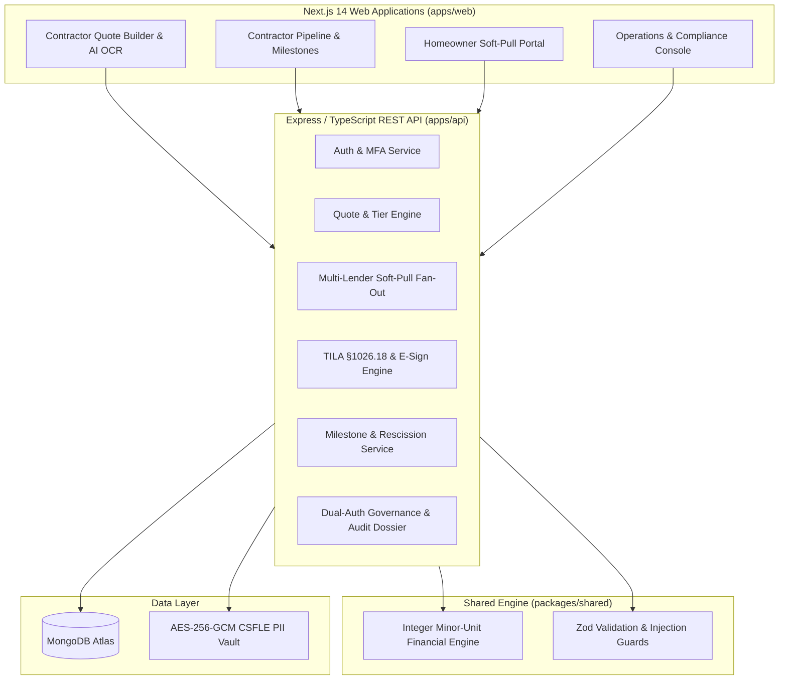

# GreenQuote — Embedded Clean Energy Financing Platform

> **Production-grade residential clean energy loan marketplace connecting HVAC/solar contractors, consumers, and green lenders with zero dealer fees, certified equipment verification, and strict regulatory compliance.**

[](https://www.typescriptlang.org/)
[](https://nextjs.org/)
[](https://nodejs.org/)
[]()
[]()

---

## 1. Executive Summary

Residential clean energy adoption (cold-climate heat pumps, rooftop solar, battery storage) has historically been hindered by opaque financing: predatory contractor markups, hidden 15–30% "dealer fees", floating-point rounding errors, and unverified rebate assumptions.

**GreenQuote** solves this by embedding transparent, multi-lender credit directly into the contractor quote-building workflow:
- **Zero Dealer Fee & Price Parity (FR-308):** Financed pricing is strictly identical to cash pricing.
- **Contractor Rate Buy-Down Cap (FR-603):** Promotional interest rate buy-downs capped at 5% and transparently badged.
- **Multi-Lender Soft-Pull Fan-Out (FR-601):** Simultaneous query of prime credit unions and green banks with **0 impact** to consumer FICO score.
- **Certified Equipment & Automated Rebates (FR-401, FR-402):** AHRI/NEEP equipment catalog validation paired with IRA HOMES / Section 25C and state rebate engine.
- **Regulatory E-Sign & TILA Reg Z Closing (FR-701–704):** Mandatory Truth in Lending Act §1026.18 disclosures before signature canvas unlocks, sealed with SHA-256 digital hashes.
- **Milestone Payout & 3-Day Rescission Gate (FR-801–805, CMP-07/08):** Payout releases gated by verified equipment nameplates and statutory 3-business-day cooling-off hold.
- **Operations Console with Dual-Authorization (FR-1001–1004):** Four-eyes governance on lender underwriting parameters and sealed 7-year regulatory compliance dossiers.

---

## 2. System Architecture



---

## 3. Monorepo Structure

```
greenquote/
├── apps/
│   ├── api/             # Express.js REST API (Port 4000)
│   │   ├── src/modules/ # Quotes, Prequal, Offers, Esign, Milestones, Admin, AI
│   │   ├── src/security/# AES-256-GCM PII Vault & CSFLE
│   │   └── src/scripts/ # Database seed script (realistic end-to-end journey)
│   ├── web/             # Next.js 14 App Router Frontend (Port 3000)
│   │   ├── src/app/     # Contractor, Homeowner, Operations routes
│   │   └── src/components/
│   └── worker/          # Background worker (Agenda / Cron jobs)
├── packages/
│   ├── shared/          # Financial calculator, TILA formulas, Zod schemas, types
│   └── ui/              # Shared Tailwind CSS design system tokens
└── docs/                # Architecture, API, Database Schema, Defense Guide
```

---

## 4. Regulatory Compliance Matrix

| Regulation | Scope | Implementation |
|---|---|---|
| **TILA / Reg Z §1026.18** | Truth in Lending Act | Strict APR, Finance Charge, Amount Financed, Total Payments tabular disclosures prior to signature |
| **FCRA §604** | Fair Credit Reporting Act | Explicit soft-pull consent modal; zero consumer credit score impact |
| **ECOA / Reg B** | Equal Credit Opportunity Act | Adverse Action notice engine with specific credit denial reasons |
| **FTC Cooling-Off Rule** | 16 C.F.R. Part 429 | Statutory 3-business-day cancellation hold before milestone payout disbursement |
| **TILA Reg Z §1026.23** | Right of Rescission | 3-business-day rescission clock calculated skipping Sundays and federal holidays |
| **E-SIGN Act** | 15 U.S.C. §7001 | Affirmative consent, PDF viewability proof, and SHA-256 tamper-evident integrity hash |
| **GLBA Safeguards** | PII Protection | AES-256-GCM field-level encryption for SSN, income, and financial records |
| **Four-Eyes Principle** | Dual Authorization | Underwriting and lender parameters require independent second-officer approval (FR-1002) |

---

## 5. Getting Started (Local Development)

### Prerequisites
- Node.js 20+
- npm 10+
- MongoDB 7.0+ (Local or MongoDB Atlas)

### Installation
```bash
# Clone the repository
git clone <repo-url>
cd GreenQuote/greenquote

# Install all workspace dependencies
npm install

# Copy environment files
cp apps/api/.env.example apps/api/.env
cp apps/web/.env.example apps/web/.env

# Seed sample data (contractor, sample quotes, lender offers, milestones)
npm run seed --workspace=@greenquote/api
```

### Running Locally
```bash
# Start backend API (http://localhost:4000)
npm run dev --workspace=@greenquote/api

# Start Next.js frontend (http://localhost:3000)
npm run dev --workspace=@greenquote/web
```

---

## 6. Testing & Quality Verification

Run complete test suite across all monorepo workspaces:
```bash
# Run TypeScript compilation check (0 errors across 5 workspaces)
npm run typecheck

# Run test suites (34 passed / 34 total)
npm run test

# Run Next.js production build
npm run build --workspace=@greenquote/web
```

---

## 7. Evaluator & Internship Defense Guide

For evaluation walkthroughs, 5-minute live demo scripts, and architectural defense questions:
👉 **[Read the Master Internship Project Guide](docs/INTERNSHIP_PROJECT_GUIDE.md)**
