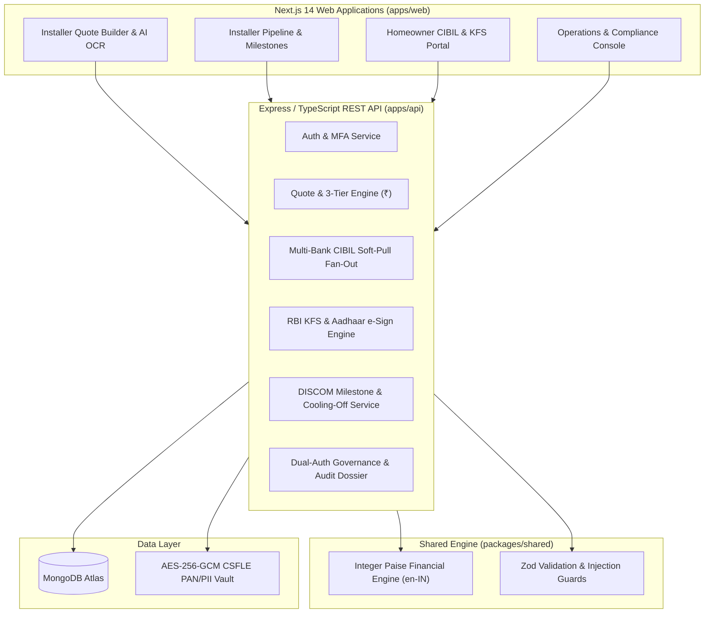

# GreenQuote India — Embedded Clean Energy POS Lending & PM Surya Ghar Subsidy Infrastructure

> **Production-grade residential clean energy point-of-sale loan marketplace connecting rooftop solar installers, homeowners, and green lenders (State Bank of India, Tata Capital, IREDA) with ₹0 dealer fees, verified MNRE ALMM equipment, automated PM Surya Ghar DBT subsidies, and RBI Digital Lending compliance.**

[](https://www.typescriptlang.org/)
[](https://nextjs.org/)
[](https://nodejs.org/)
[-emerald.svg)]()
[](https://pmsuryaghar.gov.in/)
[]()
[]()

---

## 1. Executive Summary

Residential clean energy adoption across India (rooftop solar, hybrid PCUs, lithium battery storage, 5-star inverter heat pump ACs) is experiencing exponential growth, supercharged by the Government of India's **PM Surya Ghar: Muft Bijli Yojana** (1 Crore solar rooftop households target). However, adoption has historically been constrained by fragmented financing: opaque contractor pricing, unverified subsidy deductions, predatory loan dealer markups, manual paper underwriting, and lengthy DISCOM approval delays.

**GreenQuote India** solves this by embedding transparent, multi-bank point-of-sale credit directly into the solar installer quote-building and customer journey:
- **₹0 Hidden Dealer Fees & Single-Price Policy:** Financed pricing is strictly identical to cash pricing (guaranteed zero dealer fee markups).
- **PM Surya Ghar Instant POS Netting:** Upfront ₹60,000 to ₹78,000 central DBT subsidy deduction from the homeowner invoice, avoiding consumer liquidity lockup.
- **Multi-Bank CIBIL Soft-Pull:** Pre-qualifies homeowners across top institutional clean energy lenders (**State Bank of India**, **Tata Capital**, **IREDA**) in under 60 seconds with **0 impact** to CIBIL credit scores.
- **Verified MNRE ALMM Equipment Catalog:** Catalog integration with the Ministry of New & Renewable Energy Approved List of Models and Manufacturers (**Waaree Energies**, **Tata Power Solar**, **Adani Solar**, **Havells**).
- **Reserve Bank of India (RBI) Key Fact Statement (KFS):** Strict reducing balance APR disclosures, nil foreclosure fees, and statutory 3-day cooling-off exit rights prior to digital execution.
- **Aadhaar OTP Digital Execution:** Compliant electronic signature execution under Section 3A of the Information Technology Act 2000 with SHA-256 tamper-evident integrity seals.
- **Milestone Payouts via RTGS/NEFT:** Payout releases gated by verified equipment serials and DISCOM net-metering inspection reports.
- **Operations Console with Dual-Authorization:** Four-eyes governance on lender credit parameters and sealed 7-year regulatory compliance dossiers.

---

## 2. System Architecture



---

## 3. Monorepo Structure

```
greenquote/
├── apps/
│   ├── api/             # Express.js REST API (Port 4000)
│   │   ├── src/modules/ # Quotes, Prequal, Offers, KFS, Milestones, Admin, AI
│   │   ├── src/security/# AES-256-GCM PII Vault & CSFLE (PAN, bank credentials)
│   │   └── src/scripts/ # Database seed script (SunVolt, PM Surya Ghar, SBI/Tata Capital)
│   ├── web/             # Next.js 14 App Router Frontend (Port 3000)
│   │   ├── src/app/     # Homeowner quote, Installer builder, Lender portal, Admin console
│   │   └── src/components/
│   └── worker/          # Background worker (Agenda / Cron jobs)
├── packages/
│   ├── shared/          # Financial calculator (₹), actuarial EMI formulas, Zod schemas, types
│   └── ui/              # Shared Tailwind CSS design system tokens
└── docs/                # Architecture, API, Database Schema, Regulatory Guides
```

---

## 4. Indian Regulatory Compliance Matrix

| Regulation / Standard | Authority | Implementation in GreenQuote |
|---|---|---|
| **RBI Digital Lending Guidelines (2022/2024)** | Reserve Bank of India | Mandatory Key Fact Statement (KFS), reducing balance APR, zero hidden dealer fees, direct bank-to-installer disbursals |
| **CICRA 2005 (CIBIL Soft Bureau Pull)** | RBI / Credit Information Companies | Explicit digital consent for soft credit bureau pull; zero score impact |
| **RBI Fair Practices Code** | Reserve Bank of India | Standardized disclosures, adverse action transparency, grievance redressal officer contact |
| **RBI 3-Day Cooling-Off Directive** | Reserve Bank of India | Unconditional right to exit loan contract within 3 business days without prepayment penalty |
| **Information Technology Act 2000 (Section 3A)** | Ministry of Electronics & IT (MeitY) | Aadhaar OTP electronic signature with SHA-256 tamper-evident digital seal |
| **Digital Personal Data Protection (DPDP) Act 2023** | Government of India | AES-256-GCM field-level encryption for PAN, income, and bank credentials |
| **MNRE ALMM Mandate** | Ministry of New & Renewable Energy | Hardware catalog strictly filtered by Approved List of Models and Manufacturers |

---

## 5. Getting Started (Local Development)

### Quick Start with Docker (Recommended)
Launch the entire platform including MongoDB 7.0, Express REST API, and Next.js frontend with a single command:
```bash
docker compose up --build
```
- **Web Application:** [http://localhost:3000](http://localhost:3000)
- **API Server:** [http://localhost:4000](http://localhost:4000)
- **Database:** `mongodb://localhost:27017/greenquote`

---

### Manual Local Development Setup
#### Prerequisites
- Node.js 20+
- npm 10+
- MongoDB 7.0+ (Local or MongoDB Atlas)

#### Installation
```bash
# Clone the repository
git clone https://github.com/MohitMulik/GreenQuote.git
cd GreenQuote/greenquote

# Install all workspace dependencies
npm install

# Build shared packages
npm run build --workspace=@greenquote/shared

# Copy environment files
cp apps/api/.env.example apps/api/.env
cp apps/web/.env.example apps/web/.env

# Seed sample data (SunVolt Green Energy, PM Surya Ghar quotes, SBI/Tata Capital offers)
npm run seed --workspace=@greenquote/api
```

#### Running Locally
```bash
# Start backend API (http://localhost:4000)
npm run dev --workspace=@greenquote/api

# Start Next.js frontend (http://localhost:3000)
npm run dev --workspace=@greenquote/web
```

---

## 6. Testing & Quality Verification

Run complete test suite across all monorepo workspaces:
```bash
# Run TypeScript compilation check
npm run typecheck

# Run test suites (financial calculations, EMI precision, parity checks)
npm run test

# Run Next.js production build
npm run build --workspace=@greenquote/web
```


---

## 7. License

This project is licensed under the MIT License — see the [LICENSE](LICENSE) file for details.
