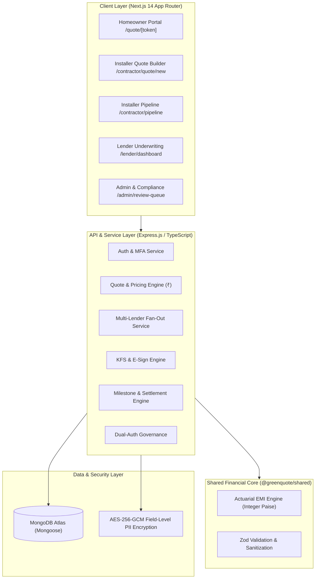

# GreenQuote India — Embedded Clean Energy POS Lending & PM Surya Ghar Subsidy Infrastructure

> **A production-grade FinTech point-of-sale (POS) lending and subsidy orchestration platform connecting rooftop solar installers, residential homeowners, and institutional green lenders (State Bank of India, Tata Capital, IREDA) with ₹0 dealer fees, verified MNRE ALMM hardware catalogs, and strict RBI Digital Lending compliance.**

[](https://www.typescriptlang.org/)
[](https://nextjs.org/)
[](https://nodejs.org/)
[](https://www.mongodb.com/)
[](https://tailwindcss.com/)
[](https://jestjs.io/)
[](LICENSE)

---

## 1. Overview & Core Engineering Highlights

Residential clean energy adoption in India (rooftop solar, hybrid inverters, battery storage) has historically faced major friction: opaque contractor pricing, unverified subsidy promises, high upfront capital expenditure, hidden dealer fees, and complex bank loan applications.

**GreenQuote India** solves this by embedding transparent, multi-lender credit and instant government subsidy netting directly into the installer's quote generation workflow and customer experience.

### Key Engineering Features

- **Integer Minor-Unit Financial Engine (`@greenquote/shared`):** Implements integer arithmetic in minor units (paise) across all loan calculations, completely eliminating IEEE 754 floating-point rounding errors in APR amortization, monthly EMI determination, and payment schedules.
- **₹0 Hidden Dealer Fees & Single-Price Policy:** Real-time parity validation ensuring that financed customer pricing matches cash pricing with zero hidden dealer fee markups.
- **PM Surya Ghar Instant POS Netting:** Upfront automated netting of central Direct Benefit Transfer (DBT) subsidies (₹60,000 to ₹78,000) directly on the customer invoice, eliminating consumer capital lockup.
- **Multi-Bank CIBIL Soft-Pull Integration:** Simultaneous parallel query fan-out across participating lenders (**State Bank of India**, **Tata Capital**, **IREDA**) returning personalized EMI offers in under 60 seconds with **zero impact** on the consumer's CIBIL credit score.
- **MNRE ALMM Hardware Catalog Verification:** Automatic validation of solar modules and inverters against the Ministry of New & Renewable Energy Approved List of Models and Manufacturers (**Waaree Energies**, **Tata Power Solar**, **Adani Solar**, **Havells**).
- **RBI Digital Lending & Key Fact Statement (KFS) Engine:** Generates legally binding Key Fact Statements detailing reducing-balance APR, zero foreclosure penalty, and a mandatory 3-day cooling-off cancellation period prior to execution.
- **Aadhaar OTP Digital E-Sign:** Seamless electronic signature workflow under Section 3A of the Information Technology Act 2000, sealed with SHA-256 tamper-evident integrity hashes.
- **AI-Powered Quote Digitizer & OCR:** Computer vision and multimodal parsing engine converting legacy paper/PDF contractor quotes into structured 3-tier Good / Better / Best digital proposals.
- **Four-Eyes Governance & Audit Logging:** Dual-authorization controls on lender credit policy changes, contractor KYB verification (GSTIN & MNRE Empanelment), and tamper-proof immutable audit logging.

---

## 2. System Architecture



---

## 3. Monorepo Organization

```
greenquote/
├── apps/
│   ├── web/             # Next.js 14 App Router frontend (Tailwind CSS, Lucide Icons)
│   │   ├── src/app/     # Homeowner quote, Installer pipeline, Lender dashboard, Admin console
│   │   └── src/lib/     # API client and responsive layout helpers
│   ├── api/             # Modular Express.js REST API
│   │   ├── src/modules/ # Quotes, Prequalification, Offers, Milestones, KYB, OCR
│   │   ├── src/security/# AES-256-GCM PII encryption vault (PAN, banking credentials)
│   │   └── src/scripts/ # Database seed automation
│   └── worker/          # Background worker queue for async webhooks and reconciliation
├── packages/
│   ├── shared/          # Financial calculator, APR amortization, Zod schemas, types
│   └── ui/              # Shared design tokens and Tailwind component styling
└── docs/                # Architecture specifications, API documentation, and database schemas
```

---

## 4. Indian Regulatory & Compliance Standards

| Standard / Regulation | Regulatory Body | Implementation in GreenQuote |
|---|---|---|
| **RBI Digital Lending Directions (2022/2024)** | Reserve Bank of India | Standardized Key Fact Statement (KFS), reducing balance APR, zero hidden dealer fees, direct milestone payouts |
| **CICRA 2005 (CIBIL Soft Bureau Inquiry)** | RBI / Credit Bureaus | Explicit consumer consent for soft bureau inquiry; zero score impact |
| **RBI Fair Practices Code** | Reserve Bank of India | Transparent fee schedule, adverse action notifications, grievance redressal mechanism |
| **RBI 3-Day Cooling-Off Directive** | Reserve Bank of India | Unconditional right to exit clean energy credit contracts within 3 business days without penalty |
| **Information Technology Act 2000 (Section 3A)** | MeitY | Aadhaar OTP electronic signature with SHA-256 tamper-evident digital seal |
| **DPDP Act 2023 (Data Protection)** | Government of India | AES-256-GCM field-level encryption for PAN, income, and bank credentials |
| **MNRE ALMM Mandate** | Ministry of New & Renewable Energy | Hardware catalog strictly verified against the Approved List of Models and Manufacturers |

---

## 5. Getting Started

### Prerequisites
- **Node.js**: v20.0.0 or higher
- **npm**: v10.0.0 or higher
- **MongoDB**: v7.0 or higher (Local or MongoDB Atlas)

### Installation & Local Setup

```bash
# 1. Clone the repository
git clone https://github.com/MohitMulik/GreenQuote.git
cd GreenQuote/greenquote

# 2. Install dependencies across all monorepo workspaces
npm install

# 3. Build shared packages
npm run build --workspace=@greenquote/shared

# 4. Configure environment variables
cp apps/api/.env.example apps/api/.env
cp apps/web/.env.example apps/web/.env

# 5. Seed sample demonstration data
npm run seed --workspace=@greenquote/api

# 6. Start development servers
npm run dev:api    # Starts REST API on http://localhost:4000
npm run dev:web    # Starts Next.js frontend on http://localhost:3000
```

---

## 6. Testing & Quality Assurance

The codebase includes comprehensive unit and integration test suites:

```bash
# Type check all workspaces
npm run typecheck

# Run test suites (financial engine, APR solver, parity validation)
npm run test

# Run Next.js production build
npm run build --workspace=@greenquote/web
```


---

## 7. License

This project is licensed under the MIT License — see the [LICENSE](LICENSE) file for details.
