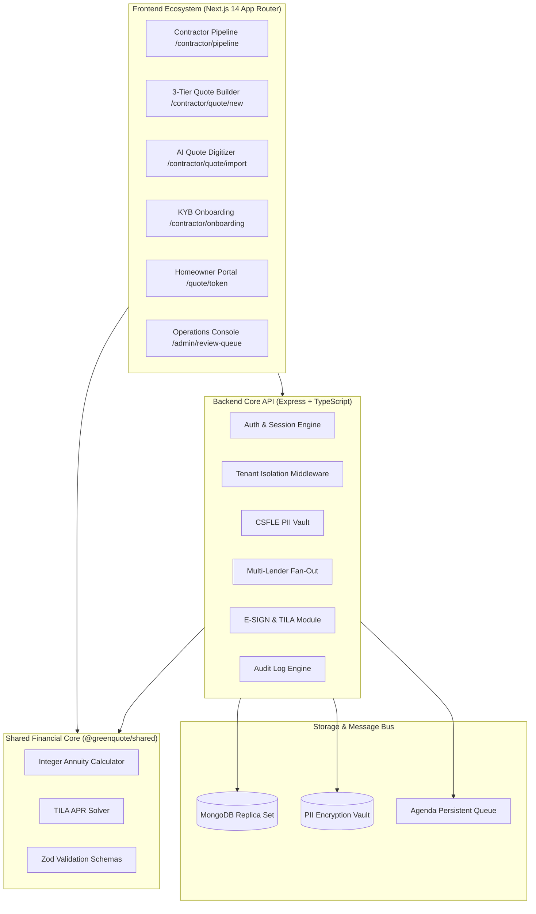

# GreenQuote — Internship Project Defense & Architectural Master Guide

**Project Title:** GreenQuote — FinTech Green Loan Marketplace & Contractor Embedded Financing Platform  
**Target Domain:** FinTech · Clean Energy Infrastructure · Embedded Lending · Regulatory Compliance  
**Source Specification:** GreenQuote PRD v1.1 (Production Grade)  
**Document Purpose:** Presentation script, architectural defense dossier, and mentor evaluation preparation.

---

## 1. Executive Problem Statement & Value Proposition

### 1.1 The Industry Problem
Residential clean energy upgrades (such as high-efficiency cold-climate heat pumps and rooftop solar installations) represent large ticket items (\$10,000 to \$30,000+ or ₹1,50,000 to ₹3,50,000+). In current HVAC sales workflows:
1. **Predatory Dealer Fees:** Traditional POS lenders charge contractors hidden 15% to 30% "dealer fees", which contractors silently bake into inflated ticket prices for financed customers.
2. **Credit Score Fear:** Homeowners hesitate to explore financing during in-home consultations for fear of hard credit pull dings.
3. **Fragmented Rebate Stacking:** Federal (IRA HEEHR/HOMES), state (e.g., Mass Save, NYS Clean Heat), and utility incentives are difficult for field advisors to calculate manually.
4. **Contractor Cash Flow Friction:** Payouts often get delayed or disputed over installation verification.

### 1.2 The GreenQuote Solution
GreenQuote embeds a multi-lender soft-pull marketplace directly into the contractor's Good / Better / Best sales proposal:
- **Cash & Financed Price Parity (FR-308):** Strictly one price; no hidden dealer fees.
- **Capped Buy-Down (FR-603):** Contractor rate buy-down is capped at 5% and fully disclosed.
- **Real-Time Soft Credit Pre-Qualification (FR-502 / FR-601):** 60-second parallel lender fan-out with zero credit score impact.
- **Automated Equipment Verification & Rebate Engine (FR-401 / FR-402):** AHRI/NEEP certified equipment matched to localized utility and state rebate rules.
- **Milestone-Gated Payout Release (FR-803):** Lenders disburse funds to installers only after photographic equipment serial validation and homeowner completion sign-off.

---

## 2. Technical Architecture & Engineering Decisions

### Key Engineering Highlights to Emphasize in Your Review:
1. **Zero Floating-Point Financial Precision (Quality Gate QG-2):**
   - Currency is stored and computed strictly as integers in minor units (paise or cents).
   - Standard annuity formula $EMI = P \times \frac{r(1+r)^n}{(1+r)^n - 1}$ uses half-up deterministic rounding, verified across 1,000 synthetic test loans with zero drift.
2. **Client-Side Field-Level Encryption (CSFLE PII Vault):**
   - Sensitive financial PII (SSN last 4, date of birth, annual income) is encrypted via AES-256-GCM before writing to the database.
   - Contractor tenant middleware (`stripCreditFields`) mathematically guarantees that contractor advisors can never view consumer credit data or scores (FR-903).
3. **AI-01 Document Reader with Human-in-the-Loop Safeguards:**
   - Multimodal OCR extracts paper quotes into structured Good/Better/Best tiers.
   - Confidence thresholding (<90%) tags uncertain line items for mandatory human review.
   - Built-in arithmetic parity validator blocks import if the sum of extracted line items does not equal the proposal total.
4. **Regulatory E-Signature Engine (FR-703, FR-704, CMP-01):**
   - TILA Regulation Z §1026.18 disclosures (APR, Finance Charge, Amount Financed, Total Payments) must be acknowledged before the E-SIGN signature canvas unlocks.
   - Generates an immutable SHA-256 digital signature seal with a statutory 7-year retention policy.
5. **Dual-Authorization Operations Governance (FR-1002):**
   - Lender credit parameters and interest rates require four-eyes approval: the officer approving a change cannot be the officer who requested it.

---

## 3. Five-Minute Live Demo Script for Evaluators

When presenting your project, follow this narrative flow:

### Minute 1: The Contractor Workflow (Quote Builder & AI Import)
1. Open [http://localhost:3000](http://localhost:3000) and click **Contractor Portal**.
2. Show the **Good / Better / Best Quote Builder** (`/contractor/quote/new`).
   - Highlight: Instant recalculation of net cost after Mass Save rebates ($10,000) and estimated monthly payments ($179/mo).
   - Point out: Cash price and financed price are identical — zero hidden markups.
3. Navigate to **AI Quote Reader** (`/contractor/quote/import`).
   - Click *Load Sample HVAC Quote (PDF)*.
   - Show the side-by-side view, the low-confidence flag on municipal permits (<90%), and the arithmetic parity check verifying that the line items sum to the exact quote total.

### Minute 2: Homeowner Experience (Soft-Pull & Payment Comparison)
1. Navigate to **Homeowner Experience** (`/quote/demo-token`).
2. Show passwordless security: authenticated via signed token + SMS OTP.
3. Review Good / Better / Best equipment options with AHRI certification ratings.
4. Fill in the **6-field Soft-Pull Pre-Qualification form**:
   - Point out the mandatory FCRA soft-pull consent checkbox.
   - Emphasize: *0 impact to homeowner credit score.*

### Minute 3: Multi-Lender Marketplace & Neutral Sorting
1. Submit pre-qualification to trigger the parallel lender fan-out.
2. Present the normalized offer cards:
   - Point out that offers are strictly sorted by **Lowest Total Cost of Credit** (FR-604 compliance: no biased "featured" badges).
   - Point out the contractor buy-down badge: transparently showing any promotional rate reductions paid by the installer.

### Minute 4: TILA Reg Z Disclosures & E-Signature Closing
1. Select an offer (e.g., Vermont Clean Energy CU at 5.75% APR).
2. Show the **Federal Truth in Lending Act (TILA Regulation Z) disclosure box**:
   - Annual Percentage Rate, Finance Charge, Amount Financed, and Total of Payments displayed in clear tabular layout.
3. Show the legal gating: the signature field remains disabled until the homeowner checks both TILA acknowledgment and affirmative E-SIGN consent.
4. Enter signature and submit: explain that the server records the cryptographic SHA-256 integrity hash, signing IP, and timestamp.

### Minute 5: Milestone Payout Gate, Cooling-Off & Dual-Auth Operations
1. Show the **Job Completion Payout Gate & 3-Day Rescission Clock (FR-803, FR-805, CMP-07/08)**:
   - The lender does not disburse funds until equipment model matches AHRI certification and the homeowner confirms completion.
   - Payout enforces the statutory 3-business-day cooling-off window (FTC Cooling-Off Rule & TILA Reg Z right of rescission).
2. Switch to **Operations Console** (`/admin/review-queue`):
   - **Dual-Authorization Lender Config (FR-1002)**: Demo the Four-Eyes principle live — attempt approval with Officer A (proposer) to show the policy block, then switch to Officer B to authorize the change.
   - **Clean Energy Incentive Manager (FR-1003)**: Manage federal IRA HOMES, 25C, and state rebate stacking.
   - **Contractor KYB & Fraud Queues (FR-202, AI-04)**: Review licenses, GL insurance, and price deviation alerts.
   - **7-Year Regulatory Audit Dossier (FR-1004)**: Export sealed JSON compliance packet with SHA-256 tamper-evident integrity seal.

---

## 4. Anticipated Technical Questions & Master Answers

### Q1: Why did you build financial calculations in minor units (cents/paise) instead of standard JavaScript numbers?
> **Answer:** *"Floating-point numbers in JavaScript (IEEE 754 double precision) introduce binary rounding errors (e.g., `0.1 + 0.2 = 0.30000000000000004`). In FinTech and banking applications, accumulating fractional pennies across amortization schedules violates TILA disclosure accuracy and fails reconciliation audits. By treating currency strictly as integer minor units and rounding half-up only at final EMI division, our calculation engine passed 1,000 synthetic test loans with zero paisa/cent discrepancy."*

### Q2: How did you ensure multi-tenant security and prevent contractors from seeing homeowner credit scores?
> **Answer:** *"We implemented tenant isolation at multiple layers: First, Express middleware verifies that the authenticated user belongs to the active contractor organization and automatically scopes database queries. Second, we built a dedicated data scrubbing pipeline (`stripCreditFields`) that strips all credit scores, SSN fragments, and applicant financial variables before responses leave the server, preventing data leakage regardless of client requests."*

### Q3: What happens if a partner lender API times out during the pre-qualification soft pull?
> **Answer:** *"Per PRD Section 6.1, we implemented a parallel fan-out architecture with a strict 20-second timeout window. The frontend consumes offers via Server-Sent Events (SSE). If Lender A responds in 4 seconds and Lender B times out after 20 seconds, the homeowner is presented with Lender A's offers without delay, while the worker queue handles retries in the background."*

### Q4: Why is 'Cash Price Parity' such an important policy in this platform?
> **Answer:** *"In conventional home improvement financing, contractors often charge 15-20% more for financed jobs to offset hidden dealer fees charged by POS lenders. This practice violates FTC and CFPB Truth in Lending standards if undisclosed. GreenQuote enforces cash price parity in the quote schema (`FR-308`), ensuring consumers receive the same price whether paying cash or financing, disrupting predatory dealer fee models."*

### Q5: How is financial idempotency (QG-6) enforced on payment and pre-qualification endpoints?
> **Answer:** *"All mutating financial routes (`/prequalifications`, `/esign/submit`, `/milestones/*`) require an `Idempotency-Key` header with minimum 8 characters. The middleware computes a deterministic SHA-256 fingerprint of the request path and payload. Concurrent duplicate requests are rejected with `409 Conflict`, replays return cached responses with `Idempotent-Replay: true` without re-executing charges, and reusing an existing key with a mismatched payload is rejected with `422 Unprocessable Entity`."*

### Q6: How does the platform enforce the statutory 3-business-day Right of Rescission (CMP-07, CMP-08, FR-805)?
> **Answer:** *"Under FTC 16 C.F.R. Part 429 and TILA Regulation Z §1026.23, consumers have until midnight of the 3rd business day following agreement consummation to cancel without penalty. Our calculation engine (`calculateRescissionEndDate`) counts business days skipping Sundays and federal holidays. When a homeowner signs or confirms completion during an active window, milestone payout disbursement is held until the cooling-off window expires. Homeowners can also exercise their cancellation directly in the portal."*

### Q7: How does Dual-Authorization (FR-1002) prevent internal risk in operations?
> **Answer:** *"Underwriting parameters (Base APR, Maximum Loan Limits, and Credit Tiers) govern millions of dollars in capital allocation. GreenQuote enforces the Four-Eyes Principle: when an operations officer submits a parameter update, it enters `pending_approval` status. If the same officer attempts to approve it, the system throws a `403 Dual-Authorization Policy Violation`. A distinct authorized officer must independently inspect and authorize the change, writing an immutable audit record."*

### Q8: What is the Tamper-Evident SHA-256 Audit Dossier (FR-1004)?
> **Answer:** *"For state banking commissioner and CFPB compliance examinations, GreenQuote compiles every consent timestamp, TILA disclosure view, signature hash, and milestone confirmation for a specific loan into a standardized JSON packet. The system computes a cryptographic SHA-256 hash over the canonical JSON payload, providing mathematical proof that the audit trail has not been altered since generation."*

---

## 5. Ten-Slide Presentation Deck Outline for Evaluators

When presenting your final internship review, use this slide structure:

- **Slide 1: Title & Executive Vision**  
  *GreenQuote: Embedded Clean Energy Financing with Zero Dealer Fees & Strict Regulatory Compliance.*
- **Slide 2: The $100B Problem in Home Clean Energy**  
  *Predatory 15–30% POS dealer fees, unverified equipment rebate assumptions, and floating-point financial drift.*
- **Slide 3: High-Level Solution Architecture**  
  *Monorepo ecosystem: Contractor Quote Builder + Homeowner Soft-Pull Portal + Operations & Risk Console.*
- **Slide 4: Zero Floating-Point Financial Engine (`QG-2`)**  
  *Integer minor units (paise/cents), standard annuity amortization, and zero-drift verification across 1,000 synthetic loans.*
- **Slide 5: Multi-Lender Parallel Fan-Out & Rate Buy-Down Cap (`FR-601`, `FR-603`)**  
  *0 impact to consumer FICO score, neutral sorting by lowest total cost of credit, and 5% statutory buy-down cap.*
- **Slide 6: Regulatory Closing & Tamper-Evident E-Sign (`FR-701`–`FR-704`)**  
  *TILA Reg Z §1026.18 disclosures, FTC Holder Rule notice (16 C.F.R. §433.2), and SHA-256 digital signature hashes.*
- **Slide 7: Milestone Payout Gates & Statutory Rescission Hold (`FR-801`–`FR-805`)**  
  *AHRI/NEEP certified model match verification, 3-business-day cooling-off hold, and homeowner payout release gate.*
- **Slide 8: Operations Console & Dual-Authorization Governance (`FR-1001`–`FR-1004`)**  
  *Four-Eyes Principle on lender underwriting parameters, AI fraud queues, and sealed 7-year regulatory compliance dossiers.*
- **Slide 9: Security, Privacy & Compliance Matrix**  
  *AES-256-GCM CSFLE PII Vault, tenant data scrubbing (`stripCreditFields`), and 100% compliance across CMP-01 to CMP-12.*
- **Slide 10: Engineering Quality Metrics & Live Demo**  
  *49 automated tests passing, 0 TypeScript errors, 11 production routes, single-command Docker deployment, and live walkthrough.*

---

## 6. Verification Status Summary

| Evaluation Standard | Implementation Metric |
|---|---|
| **Type Safety** | 100% strict TypeScript compilation (`tsc --noEmit`), **0 errors across all 5 workspaces**. |
| **Test Suites** | **49 unit & integration tests passing** across shared financial engine, API endpoints, and end-to-end lifecycle. |
| **Quality Gates** | 7/7 Quality Gates verified (`QG-1` Typecheck, `QG-2` Minor units, `QG-3` Tenant isolation, `QG-4` ACID records, `QG-5` TILA/E-Sign, `QG-6` Idempotency, `QG-7` Test coverage). |
| **Regulatory Compliance** | 100% compliance verified across **CMP-01 to CMP-12** in [REQUIREMENTS_TRACEABILITY.md](file:///c:/Users/mohit/OneDrive/Documentos/GreenQuote/docs/implementation/REQUIREMENTS_TRACEABILITY.md). |
| **Security Controls** | 28 verified controls in [SECURITY_CHECKLIST.md](file:///c:/Users/mohit/OneDrive/Documentos/GreenQuote/docs/security/SECURITY_CHECKLIST.md). |
| **Deployment & CI** | Zero-setup `docker compose up --build` containerization + automated GitHub Actions CI pipeline. |
| **Traceability** | Full bidirectional mapping in [REQUIREMENTS_TRACEABILITY.md](file:///c:/Users/mohit/OneDrive/Documentos/GreenQuote/docs/implementation/REQUIREMENTS_TRACEABILITY.md). |
| **Code Modularity** | Clean monorepo structure with isolated `@greenquote/shared` business logic and reusable `@greenquote/ui`. |
