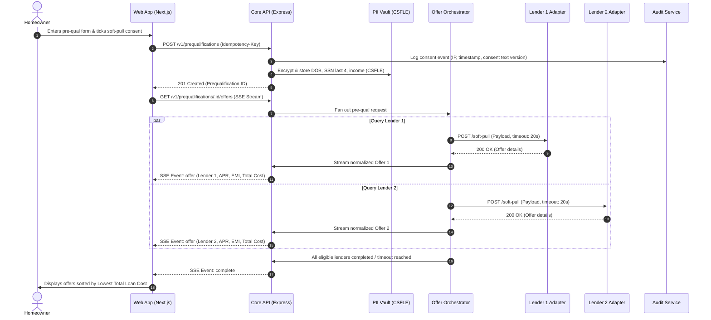

# GreenQuote — Technical Architecture Document
## Production-Grade Green Loan Marketplace Architecture

**Document Version:** 1.0  
**Status:** Approved  
**Date:** 21 November 2026  
**Reference:** PRD v1.1 Sections 10, 11, 13  

---

## 1. System Overview & Architectural Paradigm

GreenQuote is architected as a **Modular Monolith** built on the team standard stack:
- **Frontend App:** Next.js 14+ (App Router) serving responsive experiences for Contractors, Homeowners, and Operations.
- **Backend API:** Node.js LTS with Express.js (TypeScript), organized in decoupled, domain-driven modules with explicit boundary interfaces.
- **Background Worker:** Independent Node.js process leveraging Agenda (backed by MongoDB) for durable task execution, lender retries, OCR/AI inference, and webhook dispatches.
- **Data Layer:** MongoDB Atlas (Replica Set across Availability Zones) with multi-document ACID transactions and Client-Side Field-Level Encryption (CSFLE) for consumer financial PII.
- **Shared Core:** `@greenquote/shared` (types, schemas, financial math) and `@greenquote/ui` (accessible React components).

```
+-----------------------------------------------------------------------------------+
|                                 CLIENT APPLICATIONS                               |
|                                                                                   |
|  +---------------------------+  +---------------------------+  +----------------+ |
|  |     Contractor Portal     |  |     Homeowner Portal      |  |   Operations   | |
|  |     (Next.js / PWA)       |  |  (Next.js / Mobile-First) |  |    Console     | |
|  +-------------+-------------+  +-------------+-------------+  +--------+-------+ |
+----------------|------------------------------|-------------------------|---------+
                 | HTTPS / WSS / SSE            | HTTPS / SSE             | HTTPS
+----------------v------------------------------v-------------------------v---------+
|                                API GATEWAY / CORE API                             |
|                                (Node.js + Express.js)                             |
|                                                                                   |
|  +--------------------+  +--------------------+  +-----------------------------+  |
|  | Auth & RBAC (MFA)  |  | Contractor Service |  | Quote Engine (G/B/B)        |  |
|  +--------------------+  +--------------------+  +-----------------------------+  |
|  +--------------------+  +--------------------+  +-----------------------------+  |
|  | Equipment & AHRI   |  | Incentive Engine   |  | Energy Savings Calculator   |  |
|  +--------------------+  +--------------------+  +-----------------------------+  |
|  +--------------------+  +--------------------+  +-----------------------------+  |
|  | Pre-qual Orchestr. |  | Offer Normalizer   |  | Applications & E-Signature  |  |
|  +--------------------+  +--------------------+  +-----------------------------+  |
|  +--------------------+  +--------------------+  +-----------------------------+  |
|  | Milestones & Draw  |  | Payout Engine      |  | Audit & Compliance Logger   |  |
|  +--------------------+  +--------------------+  +-----------------------------+  |
|  +-----------------------------------------------------------------------------+  |
|  |                     Lender Integration Adapters (Circuit Breakers)          |  |
|  +-----------------------------------------------------------------------------+  |
+----------------------------------------+------------------------------------------+
                                         |
               +-------------------------+-------------------------+
               |                                                   |
+--------------v---------------+                  +----------------v----------------+
|    AGENDA WORKER PROCESS     |                  |           DATA TIER             |
|                              |                  |                                 |
|  - AI-01 Doc OCR / LLM Parse |                  |  +----------------------------+ |
|  - Async Webhook Processing  |                  |  | MongoDB Primary Database   | |
|  - Lender Polling & Retries  |                  |  | (Quotes, Users, Milestones)| |
|  - Email / SMS Queue         |                  |  +----------------------------+ |
|  - Nightly Reconciliation    |                  |  | PII Vault Database (CSFLE) | |
+------------------------------+                  |  | (SSN, DOB, Income, Credit) | |
                                                  |  +----------------------------+ |
                                                  |  | AWS S3 (Signed Docs / WORM)| |
                                                  +---------------------------------+
```

---

## 2. Domain Modules & Interface Boundaries

Each module inside `apps/api/src/modules/` adheres to a strict layered structure:
```
src/modules/<module_name>/
├── <module>.routes.ts      # Express routes, auth middleware, validation guards
├── <module>.controller.ts  # HTTP request/response orchestration
├── <module>.service.ts     # Pure business logic and domain rules
├── <module>.model.ts       # Mongoose schemas and database models
├── <module>.schema.ts      # Zod validation schemas
└── __tests__/              # Unit and integration test suites
```

### Module Responsibilities:
1. **Identity & Auth (`auth`):**
   - JWT issuance (15m access token in httpOnly cookie, 7d rotating refresh token).
   - Time-based One-Time Password (TOTP) MFA engine for contractor and lender roles.
   - One-time password (OTP) verification engine for passwordless homeowner access.
2. **Contractor Management (`contractors`):**
   - Profile management, business metadata, license and GL insurance tracking.
   - Payout bank account linkage with account name matching verification.
3. **Quote Builder (`quotes`):**
   - Multi-option quote creation (Good / Better / Best).
   - Dynamic price calculation based on verified line items.
   - **Absolute Constraint:** Financed price and cash price are identical (`priceMinor`).
4. **Equipment & AHRI Catalog (`equipment`):**
   - Directory of verified HVAC heat pumps, air conditioners, and solar equipment.
   - Sub-500ms text index search by model number and brand.
   - AHRI certified ratings match verification (SEER2, EER2, HSPF2).
5. **Incentive Engine (`incentives`):**
   - Location-specific rebate lookup (ZIP code + utility + income level + equipment type).
   - Rule evaluation for IRA 25C sunset, HEEHR, HOMES, and local utility subsidies.
   - Point-of-sale instant discounts vs. post-installation rebate classifications.
6. **Energy Savings Engine (`savings`):**
   - Rule-based engineering model calculating heating and cooling degree days (HDD/CDD).
   - Conservative range projection with explicit assumption reporting.
7. **Pre-qualification & Offers (`prequal`, `offers`):**
   - FCRA soft-pull consent verification and recording.
   - Parallel lender request orchestration with 20s timeout and circuit breaker protection.
   - Offer normalization into a unified schema (APR, monthly payment, total loan cost).
   - Server-Sent Events (SSE) streaming endpoint for progressive offer delivery.
8. **E-Signature & Documents (`esign`):**
   - Truth in Lending Act (TILA) Reg Z disclosure generation and view verification.
   - E-SIGN Act consent recording (IP address, user agent, timestamp).
   - Immutable signed PDF storage in encrypted object storage.
9. **Milestones & Payouts (`milestones`, `payouts`):**
   - Two-phase milestone funding: Approval draw (optional) and Completion release.
   - Installer photo and serial number evidence capture.
   - Mandatory homeowner completion sign-off barrier before payout execution.
   - Cancellation and rescission statutory cooling-off timers.
10. **Operations & Compliance (`operations`, `audit`):**
    - Platform oversight queues (KYB approval, fraud alerts, equipment mismatch).
    - Immutable, append-only compliance audit trail retained for 7 years.

---

## 3. Pre-qualification Data Flow (Sequence Diagram)



---

## 4. Multi-Tenant Data Isolation Architecture

To prevent cross-tenant data leaks:
1. Every MongoDB document in contractor-scoped collections (`quotes`, `contractorUsers`, `milestones`, `payouts`) contains an immutable `contractorId`.
2. Express authentication middleware validates the caller's JWT, extracts `contractorId`, and attaches it to `req.user`.
3. Database queries automatically inject `{ contractorId: req.user.contractorId }` via repository wrappers or Mongoose query pre-hooks.
4. Homeowner endpoints operate via single-use signed tokens (`quoteId` + HMAC signature) with no access to other contractor records.
5. Contractor accounts are cryptographically restricted from reading any homeowner credit score, bureau reason codes, or full SSN fields.

---

## 5. Money Handling & Financial Precision

In compliance with financial software engineering best practices:
1. **Zero Floating-Point Math:** All monetary quantities are represented strictly as integers in the smallest currency unit (e.g., paise for INR, cents for USD) with an explicit `currency` tag (e.g., `{ amountMinor: 20000000, currency: "INR" }`).
2. **Standard Financial Formula:**
   - Equated Monthly Installment (EMI):
     $$EMI = \frac{P \cdot r \cdot (1 + r)^n}{(1 + r)^n - 1}$$
     Where:
     - $P$ = Amount Financed (principal minus down payment, in minor units)
     - $r$ = Monthly interest rate ($\frac{\text{APR}}{12 \times 100}$)
     - $n$ = Loan term in months
   - Total Cost of Credit:
     $$\text{Total Cost} = (EMI \times n) - P + \text{Financed Fees}$$
3. **Deterministic Rounding:** Half-up rounding to the nearest minor integer.
4. **Capped Contractor Buy-Down:**
   $$\text{BuyDownMinor} \le \min(P \times 0.05, \text{MaxAllowed})$$
   Any buy-down is explicitly subtracted from the contractor's net payout, never added to the customer's cash price.

---

## 6. Security & Cryptographic Standards

- **In-Transit:** TLS 1.3 preferred, TLS 1.2 minimum. Strict-Transport-Security (HSTS) with 1-year max-age.
- **At-Rest:** MongoDB Atlas volume encryption (AES-256).
- **Client-Side Field-Level Encryption (CSFLE):** Homeowner financial attributes (`dateOfBirth`, `ssnLastFour`, `annualIncome`, `housingPayment`) are encrypted client-side by the API before passing to the database using AES-256-GCM keys managed in a Key Management Service (KMS).
- **Authentication Credentials:** Passwords hashed with bcrypt (work factor 12). TOTP secrets generated using RFC 6238 with HMAC-SHA1.
- **API Defense:**
  - `helmet` for HTTP security headers (CSP, X-Frame-Options, X-Content-Type-Options).
  - Strict CORS allow-listing based on environment.
  - Zod validation stripping all unexpected payload keys.
  - NoSQL injection barrier rejecting keys starting with `$` or containing `.`.
  - Rate limiting: 100 req/min for authenticated routes, 10 req/min for auth and pre-qual submissions.
