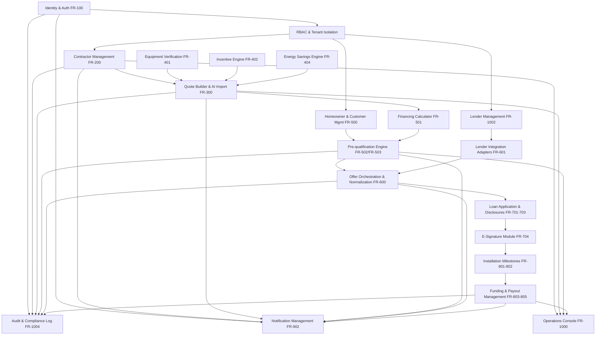

# GreenQuote — Comprehensive Implementation Plan (Phase 0)
## Production-Grade FinTech Green Loan Marketplace

**Document Version:** 1.0  
**Date:** 21 November 2026  
**Status:** Approved for Implementation  
**Source of Truth:** GreenQuote PRD v1.1  

---

## 1. Executive Summary & Repository Assessment

### 1.1 Repository State
- **Current Status:** Greenfield implementation initialized in workspace.
- **Specification:** GreenQuote PRD v1.1 (30 pages, fully extracted and analyzed).
- **Core Business Goal:** Residential heat pump and rooftop solar financing embedded directly into HVAC contractor sales quotes with instant soft-pull pre-qualifications across multiple lenders.
- **Critical Policy / Commercial Differentiators:**
  1. Cash price and financed price are strictly identical (FR-308).
  2. Contractor rate buy-down is capped at 5% and explicitly disclosed to the homeowner (FR-603).
  3. No dealer fees inflating homeowner ticket prices.
  4. Real multi-lender waterfall/parallel soft-pull pre-qualification with 0 impact to consumer credit score.
  5. Verified equipment directory (AHRI / NEEP rating data) and localized rebate engine (IRA HEEHR/HOMES, state, utility).
  6. Milestone-based payout release governed by homeowner completion sign-off and photo validation.

---

## 2. Technical Architecture Confirmation

Following the explicit confirmation aligning with the PRD v1.1 source of truth:

- **Monorepo Structure:** npm workspaces
  - `apps/web`: Next.js 14+ (App Router), React 18/19, TypeScript, Tailwind CSS, Lucide icons, React Hook Form, Zod.
  - `apps/api`: Node.js LTS, Express.js, TypeScript, Zod, Mongoose, Helmet, Pino, CORS, express-rate-limit.
  - `apps/worker`: Node.js background worker using Agenda (MongoDB-backed persistent queue) for async lender retries, OCR/document processing, notifications, and scheduled reconciliation.
  - `packages/shared`: Shared TypeScript types, Zod schemas, financial calculation utilities (EMI, APR, total cost of credit, amortizations).
  - `packages/ui`: Reusable component library (design tokens, cards, modals, form controls, financial summary tables).
- **Primary Database:** MongoDB Atlas / Replica Set with multi-document ACID transactions for financial and audit operations.
- **Security & PII Vault:** Field-level encryption (CSFLE pattern) for high-sensitivity fields (SSN last 4, date of birth, income). Masked references elsewhere.
- **AI / Document Intelligence:**
  - AI-01 (Quote & Nameplate Reader): OCR + Multimodal LLM schema-constrained JSON extraction with confidence scoring and human verification gate.
  - AI-02 (Energy Savings Engine): Deterministic degree-day engineering model (NOAA climate normals + EIA utility rates + AHRI efficiency ratios) returning transparent ranges.
  - AI-04 (Fraud & Integrity Rules): Heuristic anomaly detector (price deviation > 2.5x regional median, repeated device/phone velocity checks, equipment model mismatch).

---

## 3. Module Dependency Map

---

## 4. Frontend Screen Inventory

### 4.1 Contractor Portal (`/contractor`)
1. **S1: Authentication & Onboarding:**
   - Registration, email/password + TOTP MFA setup.
   - Business Profile: Legal name, DBA, EIN validation, address, categories.
   - KYB & Document Verification: License, General Liability Insurance with expiry tracking.
   - Payout Bank Account Verification.
   - Platform Agreement acceptance with audit logging.
2. **S2: Contractor Dashboard & Pipeline:**
   - Real-time pipeline: Draft, Sent, Viewed, Pre-Qualified, Approved, Signed, Installing, Funded.
   - Search, filter by advisor, date range, customer.
   - Metric cards: Total Financed Volume, Close Rate Lift, Active Quotes, Pending Payouts.
3. **S3: Quote Builder (Good / Better / Best):**
   - 3-tier side-by-side builder with search-as-you-type certified equipment.
   - Line items: Equipment, Labor, Electrical, Permits, Other.
   - Real-time auto-calculation of total, incentive subtractions, example EMI.
4. **S4: AI Quote Import & Verification Review:**
   - PDF/Image drag-and-drop upload.
   - Side-by-side extraction viewer: original document vs. parsed JSON fields.
   - Low-confidence field flags requiring human confirmation.
   - Arithmetic check validator (sum of lines vs. extracted total).
5. **S5: Presentation Mode:**
   - Clean, customer-facing in-home tablet view showing Good/Better/Best comparison without margin data.
6. **S6: Installation & Milestone Tracker:**
   - Upload installation photos, actual serial numbers, completed permits.
   - Trigger homeowner confirmation request.
   - Payout status monitor.

### 4.2 Homeowner Experience (`/quote/[token]`)
1. **S7: Secure Quotation View:**
   - One-time password (OTP) verification sent via SMS/Email.
   - Interactive Good / Better / Best review with detailed equipment specs and warranties.
   - Disclosed rebates (Instant POS vs. Post-install claims).
   - Energy savings range and transparent assumptions.
2. **S8: Interactive Financing Calculator:**
   - Down payment slider, term selection (12 to 120+ months).
   - Real-time estimated monthly payment (TILA-compliant trigger term disclaimer).
3. **S9: Soft-Pull Pre-qualification Form:**
   - Clean 6-field application (Name, DOB, Address, Phone, Email, Annual Income, Housing Payment, SSN Last 4).
   - Explicit FCRA/ECOA soft-pull consent checkbox with linked disclosure.
4. **S10: Multi-Lender Offer Comparison:**
   - Parallel streaming response view.
   - Normalized offer cards: APR, Monthly Payment, Term, Amount Financed, Total Loan Cost.
   - Contractor buy-down transparently badged ("Paid by your contractor").
   - Default sort: Lowest Total Cost of Credit.
5. **S11: Adverse Action / No Offers View:**
   - Respectful notification with specific partner lender adverse action reasons and next steps.
6. **S12: Loan Application & E-Signature:**
   - Hard inquiry explicit authorization.
   - Truth in Lending Act (TILA) Reg Z disclosure modal.
   - E-SIGN compliant signature canvas and audit metadata capture.
7. **S13: Job Completion Confirmation:**
   - Review installer completion photos and equipment serial numbers.
   - One-tap sign-off to authorize contractor payout release.

### 4.3 Operations Console (`/admin`)
1. **S14: Platform Overview & Analytics:**
   - Global origination metrics, lender conversion rates, regional distribution.
2. **S15: Contractor Verification Queue:**
   - Review pending KYB, insurance, and contractor license submissions.
3. **S16: Lender Management & Product Configuration:**
   - Configure credit tiers, active states, loan caps, API endpoints, circuit breakers.
   - Dual-authorization workflow for critical config updates.
4. **S17: Fraud & Anomaly Review Queue:**
   - Flagged deals (price > 2.5x median, velocity flags, equipment mismatches).
5. **S18: Incentive Program Manager:**
   - State/utility rebate rule editor with active date controls.
6. **S19: Immutable Audit Log Viewer:**
   - Full event search by entity, actor, timestamp, and exportable compliance dossiers.

---

## 5. Development Execution Phases

### Phase 1: Foundation (Weeks 1–3)
- Monorepo setup (`@greenquote/shared`, `@greenquote/ui`, `apps/api`, `apps/web`, `apps/worker`).
- MongoDB Mongoose schemas, tenant isolation middleware, and CSFLE PII vault patterns.
- Authentication & RBAC module (JWT + httpOnly cookies, TOTP MFA, OTP token engine).
- Base API error handling, validation pipelines (Zod), rate limiters, logging (Pino).
- Reusable Design System tokens and components.

### Phase 2: Contractor Ecosystem (Weeks 4–6)
- Contractor onboarding flow, KYB adapter, document upload.
- Quote Builder with Good/Better/Best multi-tier architecture.
- Secure quote link generation with expiring signed tokens.
- Customer management and contractor pipeline tracking.

### Phase 3: Energy Intelligence & AI (Weeks 7–9)
- Equipment directory with AHRI/NEEP certification seed data.
- Search-as-you-type equipment catalog with sub-500ms latency.
- Incentive engine calculating IRA HEEHR/HOMES, state, and utility rebates.
- Degree-day energy savings calculation engine.
- AI-01 Document Intelligence: OCR + LLM structured schema extractor with human review UI.

### Phase 4: Financing Marketplace Engine (Weeks 10–12)
- Financial calculation engine (EMI, APR, total repayment, buy-down calculations).
- Pre-qualification orchestration service with parallel lender fan-out.
- Lender Integration Adapters (Credit Union, Clean Energy Fund, Specialty POS Lender).
- Offer normalization, sorting by lowest total cost, and streaming SSE responses.
- Adverse action notice generation.

### Phase 5: Loan Closing & Funding (Weeks 13–14)
- Formal application handoff and hard-pull disclosure acknowledgment.
- TILA Reg Z disclosure presentation and E-SIGN signature engine.
- Milestone tracking (Approval draw vs. Completion payout).
- Installer completion evidence submission and homeowner verification sign-off.
- Payout transaction execution with idempotency.

### Phase 6: Operations & Compliance (Weeks 15–16)
- Operations console review queues (contractors, fraud flags, equipment checks).
- Searchable append-only audit log viewer.
- Incentive and lender parameter editors.
- Automated tests (unit, contract, integration, E2E), security hardening, and deployment pipelines.

---

## 6. Engineering Quality Gates

| Gate # | Quality Gate Name | Verification Criteria |
|---|---|---|
| **QG-1** | Strict Type Safety & Linting | Zero TypeScript compilation errors (`tsc --noEmit`), zero ESLint warnings on strict mode. |
| **QG-2** | Financial Precision | EMI and total loan cost calculations tested to the exact paisa/cent across 1,000 synthetic test cases. |
| **QG-3** | Tenant & PII Isolation | Multi-tenant isolation verified by automated tests; contractor cannot access credit scores or unowned quotes. |
| **QG-4** | Transactional Integrity | Payout, milestone status, and audit records written within multi-document MongoDB ACID transactions. |
| **QG-5** | Regulatory Compliance | TILA disclosures displayed prior to signature; E-SIGN consent recorded with IP/timestamp; cash/financed price parity enforced. |
| **QG-6** | Idempotency | All financial mutation endpoints require and validate `Idempotency-Key` headers. |
| **QG-7** | Test Coverage | Unit test line coverage >= 90% on financial, pricing, and compliance validation modules. |

---

## 7. Risk & Dependency Register

| ID | Risk Description | Severity | Mitigation Strategy |
|---|---|---|---|
| **R-1** | Lender API Latency / Timeouts | High | 20-second timeout window with partial response rendering; background polling and async alert notification. |
| **R-2** | Inaccurate Document Extraction (AI) | High | Human-in-the-loop review interface; confidence threshold tagging (<90%); total sum validation blocker. |
| **R-3** | Unauthorized Payout Release | Critical | Hard database constraint requiring homeowner completion confirmation record before payout request dispatch. |
| **R-4** | Regulatory Scrutiny on Dealer Fees | Critical | Systemic enforcement of single cash/financed price in quote schema and 5% cap on contractor buy-downs. |
| **R-5** | PII Exposure | Critical | Field-level encryption for SSN/DOB/Income; separate PII storage vault; zero credit data passed to contractor UI. |
